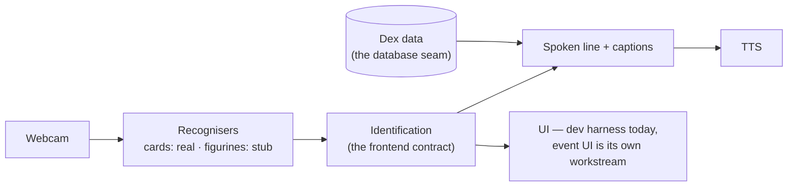

# Project 14 — Pokédex AI Outreach Activity

COMPX374-26B group project (client: Awhi Goodall, University of Waikato).
A working Pokédex for Nerdfest 2026: hold a Pokémon card or figurine up to a
camera; it recognises it, speaks the Pokédex entry in the classic robotic
voice, and — the actual point — **shows how it knew**: where the AI looked,
what it matched, how sure it was.

This repo holds the **backend and computer-vision pipeline** plus the project
docs. The event UI and the Pokédex database are separate workstreams that
plug in at documented seams — start at [docs/INTERFACES.md](docs/INTERFACES.md)
if that's your part.



## Status: walking skeleton

The full loop — identify → explain → speak — runs end to end today:

| Piece | State |
|---|---|
| Card recognition | **Real.** Contour detect → aspect-aware rectify → pHash+dHash → calibrated nearest-neighbour against a locally cached TCGdex set (Base Set) → 6-of-10 temporal vote → ORB+RANSAC geometric verify at lock-on, with live explanation overlay. |
| Figurine recognition | **Labelled stub** (canned top-5) on screen; the backend is **decided and validated** — frozen DINOv2 + cosine kNN, dry-run on the CORe50 public benchmark (96.2% burst-of-10 vote, held-out sessions). Blocked only on the real figurines — see [docs/ARCHITECTURE.md](docs/ARCHITECTURE.md). |
| Dex data | Real subset (69 species via PokeAPI), served through the database-agnostic `DexDataSource` seam. |
| Speech | Stub-grade (Windows built-in voice, offline). Pre-generated Piper WAVs later. |
| UI | OpenCV **dev harness** only — the event UI is deliberately unbuilt. |

## Quickstart

Prereqs: Python 3.11+ and Git Bash (Windows ships it with Git; the download
script uses bash + curl).

```
python -m venv .venv
.venv/Scripts/python -m pip install -r requirements.txt -r requirements-dev.txt
bash scripts/download_card_set.sh                    # cache Base Set (base1) from TCGdex
.venv/Scripts/python scripts/selftest.py             # headless end-to-end check — must print ALL PASS
```

(macOS/Linux: use `.venv/bin/python`. The card hash DB and dex data are
committed, so only the reference images need downloading.)

Run the dev harness:

```
.venv/Scripts/python -m app.main            # webcam kiosk loop
.venv/Scripts/python -m app.main --mute     # print instead of speaking
.venv/Scripts/python -m app.main --camera 1 # pick a different webcam
```

Keys: `space` identify + speak · `m` switch card/figurine mode · `q` quit.

## Layout

```
app/
  main.py                  capture loop, keys, wiring (DEV HARNESS — not the event UI)
  overlay.py               explanation panel drawn on the frame
  dex.py                   species -> spoken line, via a pluggable source
  dex_source.py            DexDataSource protocol + bundled JSON backend  ← database seam
  tts.py                   Windows System.Speech (thread, offline)
  recognisers/
    base.py                Identification dataclass  ← frontend contract
    card_matcher.py        real: detect -> rectify -> hash -> calibrated NN match
    figurine_stub.py       stub: canned closed-set output
scripts/
  download_card_set.sh     cache one TCGdex set (JSON + images), parallel curl
  build_card_db.py         hash the cached set into data/cards/hashes.json
  fetch_dex_data.py        cache PokeAPI entries for the DB's species
  selftest.py              synthetic end-to-end verification (runs in CI)
tests/                     unit tests (seam swappability) — pytest
data/
  cards/hashes.json        committed (derived, small)
  cards/images/            gitignored (TPC IP — cache locally, never commit)
  dex.json                 committed (small curated subset)
docs/                      all project documentation (see below)
```

## Documentation

| Doc | What it is |
|---|---|
| [docs/VISION.md](docs/VISION.md) | What the activity is and what success looks like |
| [docs/ARCHITECTURE.md](docs/ARCHITECTURE.md) | Two-recogniser design, diagrams, spikes, risks |
| [docs/TECH-STACK.md](docs/TECH-STACK.md) | Proposed stack with rationale + alternatives |
| [docs/INTERFACES.md](docs/INTERFACES.md) | **The team seams** — database + frontend contracts |
| [docs/CONTRIBUTING.md](docs/CONTRIBUTING.md) | Branch/PR workflow, CI, style, data rules |
| [docs/CLIENT-QUESTIONS.md](docs/CLIENT-QUESTIONS.md) | First client meeting — for the spokesperson |
| [docs/research/](docs/research/) | The evidence base behind every claim above |
| [docs/research/2026-08-07-measured-baselines.md](docs/research/2026-08-07-measured-baselines.md) | **Headline evidence** — the approach measured on our own hardware |

Everything is **preliminary until the first client meeting** — the docs exist
so the meeting and the team discussion react to something concrete rather
than to the abstract.

## Known limitations (deliberate, tracked)

- Otsu-threshold detection assumes a contrasting backdrop — which the real
  station will guarantee physically (see docs/ARCHITECTURE.md).
- Figurine mode is theatre; it says so on screen.
- Dex entries are uncurated latest-English for now — kid-safe whitelisting is
  a client sign-off item.
- Verified lock-on is validated on synthetic stress scenes; real-webcam
  validation (spike a′) closes it out.

## Near-term work

1. Client meeting #1 — [the questions](docs/CLIENT-QUESTIONS.md); the three
   big asks are venue internet, early access to the exact figurines/cards,
   and privacy/IP sign-off owners.
2. Spike (a′): the card pipeline on **real cards + our webcam** — the
   synthetic stress validation is done ([measured
   baselines](docs/research/2026-08-07-measured-baselines.md)); real
   glare/sleeve/holo footage closes it out.
3. Spike (b′): the decided figurine backend (DINOv2-kNN, validated on
   CORe50) versus its control arms on ~5 real figurines, plus the
   reference-count ablation and the **unknown-rejection hard gate**.
4. Spike (c′): the explainability displays live — the CAM budget and sanity
   gate are already measured and passing; what remains is the assembled
   30-second show and a legibility pilot.
