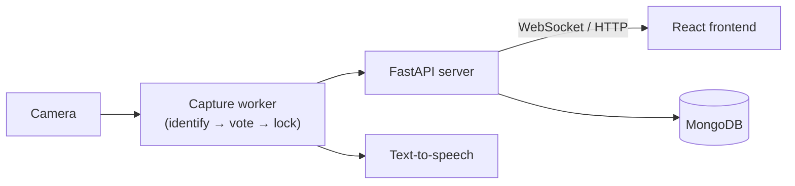

# Project 14 — Pokédex AI Outreach Activity

<!-- One-line pitch: what this is and who it's for. -->
> A program designed to act as a kiosk for an event to teach computer vision.

<!-- Hero image or GIF of the kiosk in action. Recommended width ~800px. -->


<!-- Optional badges: build status, licence, Python/Node versions. -->
<!--   -->

---

## Table of contents

- [About the project](#about-the-project)
- [Features](#features)
- [Screenshots](#screenshots)
- [How it works](#how-it-works)
- [Tech stack](#tech-stack)
- [Getting started](#getting-started)
  - [Prerequisites](#prerequisites)
  - [Quick start — Windows](#quick-start--windows)
  - [Quick start — Linux](#quick-start--linux)
  - [What the installers do](#what-the-installers-do)
  - [Running the backend manually](#running-the-backend-manually)
  - [Frontend development](#frontend-development)
  - [Adding cards and figurines](#adding-cards-and-figurines)
- [Usage](#usage)
- [Configuration](#configuration)
- [Project structure](#project-structure)
- [Testing](#testing)
- [Known limitations](#known-limitations)
- [Roadmap](#roadmap)
- [Team](#team)
- [Acknowledgements](#acknowledgements)
- [Licence](#licence)

---

## About the project

<!-- Context: why the project exists, the client, the course (COMPX374), the audience. -->

- **The goal:** This piece of software was designed for Waikato University's Nerdfest event as part of paper credit for COMPX374 (Software Engineering Industry Project). It was designed to fulfil [...]
- **The client and audience:** This was developed for a client in SCMS at the University of Waikato. The main audience of this software is people who are new to computer vision and want to see how[...]
- **What a visitor experiences:** The intended flow of this experience is to have a visitor hold a card or figurine up to the camera, let the system identify it, and then explore the results throu[...]

## Features

### **For visitors**

- **Card recognition.** Hold a Pokémon card up to the camera. The Pokédex finds the card, straightens it out, and matches it against the Base Set (cached from TCGdex). It only commits to an answ[...]
- **Figurine recognition.** Recognises ten 3D-printed figurines (nine species) from turntable reference captures, and rejects anything it hasn't seen rather than guessing.
- **Pokédex-style device UI.** The live camera feed plays inside a Pokédex shell, with its Capture and History buttons.
- **"How it knew" animation.** Pressing Capture zooms into the screen and plays an animated walkthrough of how an image classifier reaches its answer, with captions for each step. It ends on the b[...]
- **Confidence panel.** Shows the straightened card next to the top five matches, each with a confidence bar.
- **Results screen.** Official artwork plus the dex entry: name, colour-coded type pills, classification, generation, height and weight, base stats, gender split and description.
- **Honest "unsure" screen.** When confidence is low, it gives a tip (better lighting, fill more of the frame) instead of a wrong answer.
- **Spoken entries.** Reads the Pokédex entry aloud using the Windows built-in voice, offline.

### **For operators and developers**

- **Live mode switching.** Switch between card and figurine mode from the backend console without restarting.
- **Windows launcher.** `run\backend_launch.bat` sets up the venv, lists the OS's cameras by name, and takes single-key menu choices. It can relaunch with the last settings.
- **Console controls.** Keys to restart, clear the console, quit, or force a shutdown while the backend runs.
- **Dev harness.** An OpenCV debug window that draws the recognition pipeline's working over the frame, with no server or frontend needed.
- **Pluggable data seams.** Dex data sits behind a database-agnostic interface (MongoDB in deployment, bundled JSON otherwise).
- **One-step install on Windows and Linux.** An install script per OS checks for and offers to install everything needed (WSL, Docker Desktop and Python on Windows; Docker on Linux), downloads the[...]
- **Mostly offline.** Recognition, speech and dex data all run locally. The only exception is the results-screen artwork, which currently loads from the PokeAPI sprites repo.
- **Tested.** Unit tests plus a headless end-to-end self-test (`backend/scripts/selftest.py`) that runs in CI.

## Screenshots

<!-- Put images in docs/images/ and reference them relatively. Captions help. -->
| Scanning | Recognition | Results |
|:---:|:---:|:---:|
|  |  |  |
| _A visitor holding a card in front of the camera to begin detection._ | _The recogniser locks onto the card and ranks the likely matches._ | _The final Pokédex card displays the result, stats a[...]

<!-- Optional: a short demo video or GIF -->
<!-- [▶ Watch the demo](TODO-link) -->

## How it works

The project combines lightweight computer-vision detection, a voting system across multiple frames, and a polished kiosk UI. A card or figurine is captured from the webcam, processed through the m[...]

<!-- Architecture diagram (image or Mermaid). -->


- **Card lane** (`backend/app/recognisers/card_matcher.py`, `voting.py`, `verify.py`)
  1. **Find the card.** Each webcam frame is searched for a card-shaped
     outline: a four-cornered shape with a card's proportions that doesn't
     fill the whole frame.
  2. **Straighten it.** The four corners are pulled into a flat, upright
     rectangle (a perspective warp), so a tilted card looks like a scan.
  3. **Fingerprint it.** The straightened card is shrunk into two small
     "perceptual hashes" (pHash and dHash): 64-bit fingerprints that stay
     nearly the same when the lighting or sharpness changes. The fingerprint
     is compared against every card in `backend/data/cards/hashes.json` by counting
     how many bits differ. The card with the fewest differences is that
     frame's best guess.
  4. **Vote across frames.** One frame can be fooled by glare or blur, so no
     single frame decides. The last 10 frames each cast a vote for their best
     guess, and a card is chosen only once **6 of the 10** agree. Every frame
     votes, even uncertain ones, because under glare the best guess is still
     usually right even when it isn't confident.
  5. **Double-check it.** Before locking on, the artwork of the camera crop is
     compared with the downloaded reference image of the voted card. The check
     finds matching details (SIFT features) and confirms they line up as one
     flat picture (a RANSAC homography). It needs at least 40 matching points
     and 1.5× as many as the next different card. If it disagrees, the lock is
     refused and voting carries on. If the reference images aren't downloaded,
     this step is skipped.

- **Figurine lane** (`backend/app/recognisers/figurine_knn.py`, `voting.py`)
  1. **Isolate the figurine.** With a background plate (press `b` with the
     stand empty), anything that differs from the empty stand is cropped out
     as the figurine. Without a plate it uses a centre crop.
  2. **Describe it with DINOv2.** The crop goes through **DINOv2**, a vision
     model from Meta that was pre-trained on millions of images and is used
     as-is (nothing is trained here). It turns the image into an
     **embedding**: a list of 384 numbers describing what the object looks
     like, where similar-looking objects get similar numbers.
  3. **Nearest neighbour.** When the index is built, every reference frame of
     every figurine (`backend/data/figurines/index.npz`) has been embedded the same
     way. The live embedding is compared with all of them using cosine
     similarity (1.0 = identical direction), and the single closest reference
     frame names the figurine. This is a k-nearest-neighbour classifier with
     k = 1. Adding a figurine means adding its reference frames, not
     retraining.
  4. **Accept or refuse.** The answer is judged by how far it beats the best
     *different* figurine (the margin), plus a loose minimum similarity of
     0.70 to reject things that aren't figurines at all (cards score ~0.27).
     As with cards, a burst of 10 frames votes, and the answer needs 6 to
     agree, with their average similarity above the floor. This makes it
     recognise *those exact figurines*, not species in general.
- **Frontend:** The React kiosk interface presents the live camera feed, the classified results, and the explanatory walkthrough in a single, visitor-friendly screen.

For more detail see [docs/ARCHITECTURE.md](docs/ARCHITECTURE.md) and [docs/INTERFACES.md](docs/INTERFACES.md).

## Tech stack

| Area | Technology |
|---|---|
| Backend | Python 3.11+ (3.12 in Docker), FastAPI + uvicorn (HTTP, MJPEG stream, WebSocket), OpenCV (camera capture), PyMongo, python-dotenv |
| Recognition | ImageHash + Pillow (card fingerprints), OpenCV SIFT + RANSAC (card verification), PyTorch + torchvision running DINOv2 ViT-S/14 (figurine embeddings), NumPy |
| Frontend | React 19, Vite 8, Tailwind CSS 4, three.js, ESLint (airbnb config) |
| Data | MongoDB 7 (Pokédex entries, seeded by `ProcessPokeData`), JSON/NumPy reference files in `backend/data/` (card hashes, figurine index, dex subset) |
| Speech | Windows built-in `System.Speech` voice, offline |
| Deployment | Docker Compose (MongoDB, nginx serving the frontend build, backend on Linux) + install/start scripts per OS |

See [docs/TECH-STACK.md](docs/TECH-STACK.md) for the reasoning behind these choices.

## Getting started

There are two ways to run it, one per OS. Each is an install script you run
once and a start script you run every time. Once it's running, open
<http://localhost:5173>.

### Prerequisites

- A **webcam**.
- **Windows 10/11** or **Linux** (x86-64).
- An internet connection for the first install, which downloads Docker images,
  Python packages, the card reference images and the figurine model weights
  (a few GB in total).
- Everything else is handled by the installers, which ask before installing
  anything:
  - **Windows:** WSL, Docker Desktop and Python 3.12 (via `winget`).
  - **Linux:** Docker with the compose plugin (via the official
    [get.docker.com](https://get.docker.com) script, needs `sudo`).

Node.js and MongoDB are **not** needed on the host: the frontend is built and
served inside Docker, and MongoDB runs in Docker.

```bash
git clone https://github.com/KelliherL/project14-pokedex.git
cd project14-pokedex
```

### Quick start — Windows

```bat
run\install_windows.bat
run\start_windows.bat
```

1. **`run\install_windows.bat`** (once). If WSL or Docker Desktop had to be
   installed, it asks you to restart Windows. After the restart, run it again
   and it carries on from where it stopped. If Python had to be installed,
   open a new terminal and run it again.
2. **`run\start_windows.bat`** (every time). It starts Docker Desktop if needed,
   starts the **database and frontend containers**, then opens the backend
   menu (`run\backend_launch.bat`) in the same window. Pick a server mode and a
   camera, then open <http://localhost:5173>.
3. When you quit the backend, it asks whether to stop the containers too.

On Windows the backend runs natively, outside Docker, because Docker Desktop
can't pass a USB webcam through to a container.

### Quick start — Linux

```bash
./run/install_linux.sh
./run/start_linux.sh
```

1. **`./run/install_linux.sh`** (once). It offers to install Docker if it's
   missing. If your user isn't in the `docker` group, it uses `sudo docker`
   and prints how to fix that.
2. **`./run/start_linux.sh`** (every time). It asks for card or figurine mode and
   the webcam device (default `/dev/video0`), then starts all **three
   containers**: database, frontend and backend. Open
   <http://localhost:5173>. Ctrl+C stops it.
3. `./run/start_linux.sh logs` follows the logs. `./run/start_linux.sh down` removes
   the containers; the database is kept.

### What the installers do

Both are safe to re-run: finished steps are skipped.

1. Create **`.env`** from `.env.example` (see [Configuration](#configuration)).
2. Download the **card reference images** (TCGdex Base Set) into
   `backend/data/cards/images/`. They're needed for the geometric check that confirms
   a card match, and they aren't stored in git.
3. Download the **figurine model weights** (DINOv2, ~85 MB), so the first
   figurine scan doesn't stall on a download.
4. Build the Docker images (the first build takes several minutes).
5. **Seed MongoDB** with the Pokémon data, using the team's `ProcessPokeData`
   seeder from `backend/scripts/pokedb-setup.zip`.

Steps 2 and 5 (and step 3 on Linux) run as one-off containers that are deleted
when they finish; on Windows step 3 runs in `backend\.venv` instead.
Only the database and frontend (plus the backend on Linux) stay running.

On Windows the installer also creates the backend's venv (`backend\.venv`) and
installs `backend\requirements.txt` into it, so `run\backend_launch.bat` is ready to go.

| | Windows | Linux |
|---|---|---|
| Containers while running | 2: `mongo`, `frontend` | 3: `mongo`, `frontend`, `backend` |
| Backend | native, via `run\backend_launch.bat` | Docker, webcam passed through |
| Frontend | <http://localhost:5173> | <http://localhost:5173> |
| Backend API | <http://localhost:8000> | <http://localhost:8000> |

### Running the backend manually

**Windows:** `run\start_windows.bat` opens `run\backend_launch.bat` for you, and you
can also run it on its own while the containers are up.

When `run\backend_launch.bat` is run it will ask for what mode you want to run it in as well as the camera you want to use. The UI for this bat script also contains some other useful options like[...]

**Manual** (from the repo root):

```bash
cd backend
.venv\Scripts\activate            # Linux/macOS: source .venv/bin/activate
python -m app.main --mode card --camera 0
```

| Flag | Description | Default |
|---|---|---|
| `--mode` | `card` or `figurine` | `card` |
| `--camera` | Webcam index | `0` |
| `--mute` | Print instead of speaking | off |
| `--host` / `--port` | Server address | `127.0.0.1` / `8000` |
| `--dev-window` | OpenCV debug window instead of the server | off |

### Frontend development

The start scripts serve a production build of the frontend from the
`frontend` container. To work on the frontend with hot reload instead, stop
that container (it uses the same port) and run the Vite dev server:

```bash
docker compose stop frontend
cd frontend
pnpm install
pnpm dev        # http://localhost:5173
```

After frontend changes, rebuild the container with
`docker compose build frontend`. The frontend expects the backend at
`http://localhost:8000` (`frontend/src/App.jsx`).

Alternatively use your IDE of choice and use the `package.json` dev script to run it in hot reload mode. It can still connect to the backend and database docker containers while running in this m[...]

### Adding cards and figurines

No model is trained. Both lanes compare against reference data in `backend/data/`.
Run the build scripts with `backend\.venv` activated:

- **Cards.** Put the card's image in `backend/data/cards/images/` and its info in
  `backend/data/cards/meta/`, then run `python backend/scripts/build_card_db.py` to regenerate
  `backend/data/cards/hashes.json`. This takes seconds.
- **Figurines.** Add the figurine to `backend/data/figurines/sources.json`, then run
  `python backend/scripts/build_figurine_index.py`. The `source` path in
  `sources.json` is relative to the repo root, e.g.
  `assets/figurine-videos/Pikachu Model.mov`. The script embeds the reference photos or
  turntable video and writes `index.npz`, `labels.json` and `exemplars/`. This
  takes minutes on a CPU.

**Then restart the backend**: re-run `run\backend_launch.bat` on Windows, or
`docker compose restart backend` on Linux. `backend/data/` is mounted into the backend
container rather than baked into the image, so **no rebuild is needed**.

## Usage

Beyond starting the software and ensuring that all the different containers are working together, all it takes to operate this software in kiosk mode is to:
1. Ensure the backend is launched into card mode
2. Ensure that the database and frontend containers are running, plus the backend (natively via `run\start_windows.bat` on Windows, or as a container on Linux)
3. Navigate to `http://localhost:5173`
4. Show cards to the camera
5. When the confidence is showing the correct card hit capture (this will then play the animation)

**Backend console keys**
These are keys that can be pressed when clicked into the backend window to perform actions:

- **Server mode on Windows:** press them in the `run\backend_launch.bat` console.
- **Dev-window mode:** press them in the OpenCV window.
- **Linux backend container:** not available (the console key listener is Windows-only).

| Key | Action |
|---|---|
| `space` | Identify and speak |
| `m` | Switch card / figurine mode |
| `b` | Capture figurine background plate |
| `c` | Clear console |
| `r` | Restart (back to launcher menu) |
| `q` | Quit |
| `x` | Force shutdown |

## Configuration

The settings you might need to change live in one file, `.env`, in the repo
root. The install scripts create it from `.env.example`, which documents each
value. Docker Compose reads it for container settings, and the backend reads
it when run natively. The defaults work as-is; change them only for a clash
(e.g. port 27017 already taken) or a different webcam.

| Setting | Where | Default | Description |
|---|---|---|---|
| `MONGO_PORT` | `.env` | `27017` | Port on your machine where the MongoDB container is published. Change it if another MongoDB already uses 27017. |
| `MONGO_URL` | `.env` | `mongodb://localhost:${MONGO_PORT}/` | Where the **native** backend (Windows) finds MongoDB. Follows `MONGO_PORT` automatically. The Linux backend container ignores it an[...]
| `MODE` | `.env` | `card` | Recognition mode for the **Linux** backend container: `card` or `figurine`. `run/start_linux.sh` asks, using this as the default. |
| `CAMERA_DEVICE` | `.env` | `/dev/video0` | Webcam passed into the **Linux** backend container. `run/start_linux.sh` asks, using this as the default. |

Fixed in code (not in `.env`): the backend's port (`8000`, `--port` flag), the
backend address the frontend calls (`http://localhost:8000`,
`frontend/src/App.jsx`) and the frontend origin the backend allows
(`http://localhost:5173`, `backend/app/server.py`). On Windows the mode and camera are
picked in the `run\backend_launch.bat` menu instead. Feel free to adjust these within the code yourself.

## Project structure

```text
project14-pokedex/
├── backend/               # Python backend
│   ├── app/               #   camera capture loop, FastAPI server, text-to-speech
│   │   └── recognisers/   #     card matcher + verifier, figurine DINOv2 classifier, voting
│   ├── data/              #   reference data loaded at startup (mounted into Docker)
│   │   ├── cards/         #     hashes.json (committed); images/ + meta/ downloaded by the installer
│   │   ├── figurines/     #     index.npz embeddings, labels.json, exemplar thumbnails
│   │   └── dex.json       #     bundled Pokédex subset (PokeAPI)
│   ├── scripts/           #   data build tools (card DB, figurine index, dex data), selftest,
│   │                      #     card download, DB seeder (pokedb-setup.zip)
│   ├── tests/             #   unit tests (pytest)
│   ├── requirements.txt   #   (+ requirements-dev.txt, pyproject.toml)
│   └── .venv/             #   created by the Windows installer (not committed)
├── frontend/              # React kiosk UI (Pokédex shell, animation, results screen)
├── run/                   # Install and start scripts — the entry point
│   ├── install_windows.bat    # Windows: install once
│   ├── start_windows.bat      # Windows: start containers, then the backend launcher
│   ├── backend_launch.bat     # Windows: native backend menu (mode + camera)
│   ├── ensure_docker.bat      # Windows: starts Docker Desktop if it isn't running
│   ├── install_linux.sh       # Linux: install once
│   └── start_linux.sh         # Linux: start all three containers
├── docker/                # Dockerfiles: backend, frontend (build + nginx), DB seeder
├── docker-compose.yml     # mongo + frontend; backend (Linux) and one-off setup jobs via profiles
├── .env.example           # Settings template, copied to .env by the installers
├── assets/                # Team-made capture data (not loaded by the app)
│   ├── card-photos/       #   photos of real cards, normal and glare, EN and JP (test data)
│   └── figurine-videos/   #   turntable videos of the 3D-printed figurines (figurine index source)
└── docs/                  # Design and architecture docs, research notes, the standalone
                            #   recognition explainer (HTML) and the previous README
```

## Testing
Tests have not been considered for most of the project. Instead during development the contributors decided that end-to-end testing manually was the easiest. With that in mind you can still run s[...]

```bash
cd backend                  # with backend/.venv activated
pip install -r requirements-dev.txt
pytest                      # backend unit tests (tests/)
ruff check .                # Python lint
python scripts/selftest.py  # headless end-to-end check on synthetic scenes — must print ALL PASS
                            #   (needs the card images — the installer downloads them)

cd ../frontend
pnpm lint                   # frontend lint (ESLint)
```

CI (`.github/workflows/ci.yml`) runs ruff, a repo-size check, pytest and the
self-test on every push.

## Known limitations

- **Webcam and Docker.** Docker Desktop (Windows/macOS) can't pass a USB
  webcam through to a container, so on Windows the backend has to run natively
  rather than in Docker. On Linux the webcam must exist as a `/dev/video*`
  device for the backend container to start.
- **Broken characters in the seeded data.** The Pokémon dataset lost its
  accented and curly characters on import: `é` (as in Pokémon) and
  apostrophes are stored as the "unknown character" symbol (`�`). The frontend
  patches the known cases (`fixText` in `frontend/src/App.jsx`), but any other
  affected character still shows as `�` until the data is re-imported with
  the correct encoding.
- **The frontend is designed mainly for cards.** The animation, the
  straightened-crop display and the confidence panel are built around the
  card lane. Figurine mode works in the backend, but the frontend experience
  is primarily made for cards rather than figurines.
- **The Linux path has not been tested end to end.** None of the contributors has a Linux machine with a webcam. The Linux scripts pass syntax checks and shellcheck, the backend image builds, and[...]

## Roadmap

This project is not being actively maintained.

## Team

| Name   | Role               | Contact                                |
|--------|--------------------|----------------------------------------|
| Ryan   | Frontend Lead      | [Github](https://github.com/Ryan-Apk)  |
| Lachlan | Backend Lead       | [Github](https://github.com/KelliherL) |
| Seth   | Data               | [Github](https://github.com/ErgoNZ)    |
| Toby   | Art + Floating dev | TBD                                      |

## Acknowledgements

- Waikato University SCMS Division

**Data and APIs**

- [TCGdex](https://tcgdex.dev): Pokémon TCG card data and reference images (Base Set).
- [PokeAPI](https://pokeapi.co): Pokédex entries in `backend/data/dex.json`.
- [PokeAPI sprites](https://github.com/PokeAPI/sprites): official artwork on the results screen.
- [Pokédex dataset on Kaggle](https://www.kaggle.com/datasets/cristobalmitchell/pokedex?select=pokemon_utf8.csv): the Pokémon data seeded into MongoDB.

**Models and libraries**

- [DINOv2](https://github.com/facebookresearch/dinov2) (Meta AI): the pre-trained vision model behind figurine recognition.
- [PyTorch](https://pytorch.org), [OpenCV](https://opencv.org), [ImageHash](https://github.com/JohannesBuchner/imagehash), [NumPy](https://numpy.org), [Pillow](https://python-pillow.org).
- [FastAPI](https://fastapi.tiangolo.com), [uvicorn](https://www.uvicorn.org), [PyMongo](https://pymongo.readthedocs.io), [MongoDB](https://www.mongodb.com).
- [React](https://react.dev), [Vite](https://vite.dev), [Tailwind CSS](https://tailwindcss.com), [three.js](https://threejs.org).

## Licence

The source code and documentation are released under the [GNU General Public License v3.0](LICENSE). This project is free software: you can redistribute it and/or modify it under the terms of the GPL-3.0 license.

**Pokémon disclaimer**

Pokémon, Pokémon character names, artwork, card designs and Pokédex text are © Nintendo, Creatures Inc., GAME FREAK inc. and The Pokémon Company. This is a non-commercial educational project developed for COMPX374 at the University of Waikato and is not affiliated with, endorsed or sponsored by those companies.

- **Official artwork is not stored here.** Card images and official artwork are downloaded at setup or runtime from publicly available sources ([TCGdex](https://tcgdex.dev), the [PokeAPI sprites repository](https://github.com/PokeAPI/sprites)).
- **Team-made reference data is excluded from the GPL.** `assets/card-photos/`, `assets/figurine-videos/` and `backend/data/figurines/exemplars/` contain the team's own photos and videos of physical cards and figurines, which are included solely for non-commercial educational use.
- **Seeded database.** The Pokémon data seeded into MongoDB comes from an open source / public domain dataset: [Kaggle.com](https://www.kaggle.com/datasets/cristobalmitchell/pokedex?select=pokemon_utf8.csv).

See [LICENSE](LICENSE) for the full GPL-3.0 terms and the project-specific notices for assets and third-party content.
