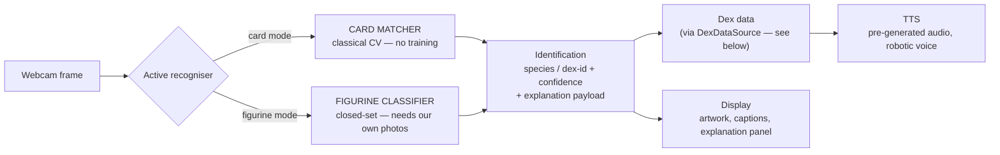
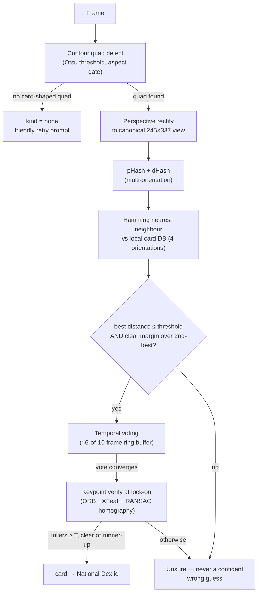
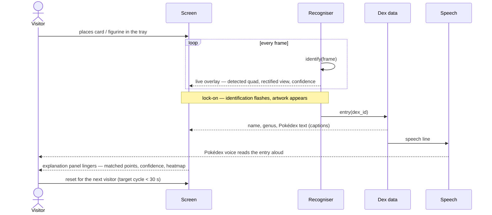
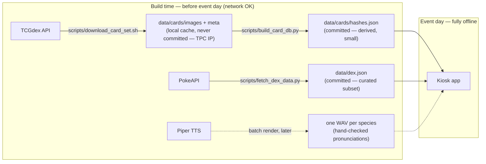

# Architecture — Pokédex AI Outreach Activity

> **Status: PRELIMINARY** — drafted 2026-07-29, revised 2026-08-06 for the
> team repo; still pre-client-meeting. Grounded in
> [the research note](research/2026-07-29-pokedex-outreach-cv.md) and the
> 2026-08-06 frontier checks, synthesised in
> [the approach note](research/2026-08-06-approach-synthesis.md) (claims
> there are graded and cited; this doc states them without repeating the
> citations), with the headline numbers re-measured on our own hardware in
> [the measured baselines](research/2026-08-07-measured-baselines.md). The
> walking skeleton in `app/` implements this shape with the figurine path
> stubbed.

## Core decision: two recognisers behind one interface

Cards and figurines are different problems and get different backends. Both
produce the same `Identification` (species/dex-id + confidence + an
*explanation payload*), so the UI, speech, and dex-data layers don't care
which one ran.

### Card path (matching problem — no training)

- **Accept criterion** is probe-calibrated (distance + margin); the
  σ-below-mean statistic is shown as the confidence display. σ alone
  under-separates junk at this DB size — measured 2026-07-29.
- **Two-layer design (2026-08-06):** the hash lane runs every frame (cheap,
  live); temporal voting + keypoint geometric verification fire once at
  lock-on. The verifier's RANSAC inlier count is both the accept gate *and*
  the match-lines display — the decision is the explanation. ORB first
  (zero new dependencies), XFeat as the evidence-backed upgrade if ORB
  proves flaky on holo cards. See
  [the card frontier check](research/2026-08-06-card-recognition-frontier.md).
- **Explanation payload:** detected quad, rectified "as the AI sees it" view,
  top-5 distance race, voting strip, keypoint match lines
  (inliers/outliers) vs the matched reference.

### Figurine path (closed-set instance recognition)

- **Primary:** frozen **DINOv2 ViT-S/14 (with registers) → cosine kNN** over
  session-diverse reference photos of the actual event figurines, captured
  on the event camera (turntable protocol). Backdrop-subtraction crop; burst
  decision over ~10 frames with similarity + margin thresholds. The exact
  engine and evaluation protocol are **already validated end-to-end on the
  CORe50 public benchmark** (50 hand-held objects, held-out sessions):
  burst-of-10 vote **96.2%** on data harder than the exhibit setting, with
  a measured reference-count knee at ~80 frames/object — see
  [the measured baselines](research/2026-08-07-measured-baselines.md).
  Figurine day is data collection, not development.
- **Control arm:** linear probe on the same embeddings + ConvNeXt-Tiny
  ImageNet fine-tune (the Pokémon-artwork checkpoint is a curiosity
  ablation only — artwork→toy rendition shift is a documented failure
  mode). DINOv3 benchmarked as a challenger, licence permitting. See
  [the figurine frontier check](research/2026-08-06-figurine-recognition-frontier.md).
- **Stretch tier (open-set fallback):** CNOS-style render templates of
  game models (~40 viewpoints/species, same DINOv2 + kNN index, lower
  trust weight) for a confidence-gated "best-effort guess" on unknown
  figurines — the sanctioned generalisation lane, never the headline
  promise. Adversarially reviewed in
  [the data-sources check](research/2026-08-06-figurine-data-sources.md);
  render assets are internal-only (IP).
- **Explanation payload:** nearest-neighbour exemplar strip (winner **and**
  runner-up), top-5 similarity bars, one Grad-CAM at lock-on targeted at
  cosine similarity to the matched exemplar. Raw attention maps and live
  UMAP projections are refused on honesty grounds — see
  [the explainability frontier check](research/2026-08-06-live-explainability-frontier.md).

### The 30-second visitor loop

## The two team seams

Both seams are specified in [INTERFACES.md](INTERFACES.md) — read that before
building against either.

1. **Database seam** — the app reads dex data only through the
   `DexDataSource` protocol (`app/dex_source.py`). The bundled
   `JsonDexSource` is the reference implementation; the team database
   replaces it by implementing the same two methods. Nothing else in the app
   may touch storage.
2. **Frontend seam** — the OpenCV window in `app/main.py` is a **dev
   harness**, not the event UI. Everything a real front-end needs arrives as
   an `Identification` (`app/recognisers/base.py`); the harness shows the
   minimum honest rendering of it.

## Components

| Component | Responsibility | Status |
|---|---|---|
| `app/recognisers/base.py` | `Identification` dataclass — the contract | real |
| `app/recognisers/card_matcher.py` | detect → aspect-aware rectify → hash → NN match + shortlist | **real** (90° presentations recovered) |
| `app/recognisers/voting.py` | 6-of-10 temporal vote over raw top-1s | **real** (locks 10/10 correct under synthetic harsh glare) |
| `app/recognisers/verify.py` | ORB+RANSAC geometric verify of the voted winner at lock-on | **real** (accept gate = the match-lines data) |
| `app/recognisers/figurine_stub.py` | closed-set classifier | **stub** (canned output, labelled STUB) |
| `app/dex_source.py` | `DexDataSource` protocol + bundled JSON backend | real (JSON reference impl) |
| `app/dex.py` | species → name/genus/flavor text, speech line | real (subset of PokeAPI data) |
| `app/tts.py` | say the line | stub-grade (Windows built-in voice; Piper later) |
| `app/overlay.py` | explanation panel drawn on the live feed | real for cards, placeholder for figurines |
| `app/main.py` | capture loop, mode switch, identify/speak | real (dev harness — event UI is the frontend team's) |
| `scripts/build_card_db.py` | hash a locally cached TCG set | real |
| `scripts/download_card_set.sh` | cache one TCGdex set (JSON + images) | real |
| `scripts/fetch_dex_data.py` | cache Pokédex entries for the DB's species | real |
| `scripts/selftest.py` | headless end-to-end verification | real (runs in CI) |
| `tests/` | unit tests (dex seam swappability) | real (runs in CI) |

## Data stores (all local, all built before event day)

- **Card DB** — `data/cards/hashes.json` (+ cached reference images,
  gitignored): built from TCGdex/pokemontcg.io. *Time-sensitive:* bulk-cache
  early — pokemontcg.io is transitioning to commercial Scrydex.
- **Dex data** — `data/dex.json`: curated English flavor texts from
  PokeAPI's static dump, control characters stripped, kid-safe entries
  whitelisted (some canonical entries are genuinely grim — curation is a
  feature, and a client sign-off item). Served to the app through
  `DexDataSource`; the team database takes over this role behind the same
  interface.
- **Figurine reference set** — photos of the actual event figurines,
  many angles/lightings, captured on the actual camera. Does not exist yet;
  **acquiring the figurines early is the project's #1 dependency.**
- **Audio** — pre-generated WAV per species (Piper), hand-checked
  pronunciations. No runtime synthesis dependency at the event.

## Event-time properties

- **Offline-first:** no network call anywhere in the identify→speak path.
- **Privacy:** frames live in memory only; nothing is written to disk.
- **Unsure is a feature:** below-threshold matches produce a friendly retry
  prompt, never a wrong guess spoken with confidence.
- **Recovery:** kiosk process auto-restarts; state is nothing more than the
  loaded DBs, so restart cost ≈ seconds.
- **Physical design:** fixed card tray + figurine stand at a set distance,
  diffuse lighting (ring light), matte dark backdrop. This is load-bearing:
  glare on holo cards, occluded card edges, and lighting drift are the
  documented top failure modes of every prior system.

## Week-1 spikes (research → verify → build)

Sharpened 2026-08-06 into one three-day harness — full falsifiable check
lists live in the frontier notes; the summary and kill criteria are in
[the approach synthesis](research/2026-08-06-approach-synthesis.md).

| # | Spike | Kills/confirms | Headline kill criterion |
|---|---|---|---|
| a′ | Cards under stress: glare/sleeve/skew video, voting, ORB inlier gap, XFeat fps | the hash-shortlist → vote → keypoint-verify design on *our* hardware/cards | confident wrong accepts under glare, or no ORB inlier gap correct-vs-impostor |
| | **Status 2026-09-15: partially run on real photos, and it hurt.** Clean English cards reach recall@10 0.833; glare drops retrieval to near zero so verify is never offered the right candidate; Japanese cards have no usable TCGdex references. A real detector bug was found and fixed. Still needs webcam **video** — voting and lock-on cannot be exercised by stills. See [the real-photo note](research/2026-09-15-card-lane-real-photos.md). | | |
| b′ | DINOv2-kNN (CORe50-validated) vs control arm on ~5 real figurines + reference-count ablation + unknown-rejection gate | the figurine backend on the *real* toys | kNN < 95% top-1 on a held-out session while the fine-tune control clears it, or unknown rejection < 90% on the matte-backdrop stand |
| c′ | The show: CAM budget + sanity tests, match-line render, legibility pilot | the explainability display stack | heatmap fails randomise-weights/swap-target sanity test → display cut |

The walking skeleton is spike (a′)'s harness plus the full-loop demo
(identify → explain → speak). The headless selftest passes on synthetic
composites; real-webcam validation on our cards is what spike (a′) closes
out.

## Open decisions (blocked on the client meeting)

1. Venue internet → is an LLM fallback path even worth building? (Default:
   no — offline-only.)
2. Staffed vs unattended → how self-explanatory the explanation panel must
   be; kiosk hardening level.
3. The exact figurine/card set + early access → figurine data collection
   schedule.
4. Explainability depth → heatmap vs match-lines vs layer-grid vs all three
   (mockups to bring to meeting #2).
5. Hardware ownership + "should it look like a Pokédex?" → laptop-only vs
   Raspberry-Pi-in-a-shell stretch goal.
6. Voice/languages/captions; kid-safe entry curation sign-off.
7. IP and camera-privacy sign-off owners.

## Risks

| Risk | Exposure | Mitigation |
|---|---|---|
| Figurines arrive late | figurine backend untrainable | escalate at meeting #1; cards carry the demo meanwhile |
| Holo glare at venue | misses on the most exciting cards | physical: diffuse light, tilt prompt; software: temporal voting |
| pokemontcg.io free tier closes | lose hi-res card DB source | cache now; TCGdex fallback verified working keyless |
| Venue lighting ≠ lab lighting | accuracy cliff on the day | dress rehearsal on-site; ring light makes us lighting-independent |
| Scope creep to open-set | demo becomes flaky | VISION.md non-goals; curated-set promise |
