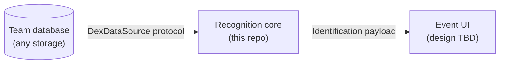

# Interface Contracts — the two team seams

> These are the boundaries other workstreams build against. If a change to
> either contract is needed, raise it before building — both sides of each
> seam are cheap to change now and expensive after the event build starts.

There are exactly two seams:

1. **Dex data source** — how the app reads Pokédex information (owner:
   database workstream).
2. **Frontend** — what a UI receives and must render (owner: UI/UX
   workstream).



---

## Seam 1 — `DexDataSource` (database workstream)

Defined in `backend/app/dex_source.py`. The app never touches storage directly;
everything reads through this protocol:

```python
class DexDataSource(Protocol):
    def entry(self, dex_id: int) -> DexEntry | None: ...
    def species_ids(self) -> list[int]: ...
```

with

```python
@dataclass(frozen=True)
class DexEntry:
    dex_id: int   # National Dex number (1..1025)
    name: str     # display name, e.g. "Pikachu"
    genus: str    # e.g. "Mouse Pokémon"
    flavor: str   # ONE Pokédex entry, plain text, TTS-ready
```

### Field semantics

- `dex_id` — National Dex number. This is the join key across the whole
  system: the card DB maps cards → dex ids, recognisers report dex ids, the
  UI fetches artwork by dex id.
- `name` — as it should be *displayed and spoken*. No decorations.
- `genus` — the "category" line ("Seed Pokémon", "Flame Pokémon"). Spoken as
  "The {genus}."
- `flavor` — exactly one entry, already chosen. Selection policy (which game
  version, which language, kid-safe whitelisting) lives on the database side
  of the seam — the app speaks whatever it is given, verbatim. Must be plain
  text: no control characters, no embedded newlines, no soft hyphens
  (PokeAPI raw text contains all three; see `backend/scripts/fetch_dex_data.py`
  for the cleaning we currently do).

### Behavioural contract

- **Read-only.** The app never writes.
- **Offline at event time.** `entry()` sits on the identify→speak path and
  is called on a keypress; it must answer locally in milliseconds. Anything
  networked must be cached/synced *before* event day.
- `entry()` returns `None` for an unknown id — the app then degrades
  gracefully (it says it isn't sure). Never raise for a missing id.
- `species_ids()` returns the ids the source can answer for, sorted. Used
  for startup sanity checks ("dex data missing").

### How to plug in

1. Implement the two methods (any class — no inheritance needed; it's a
   structural protocol).
2. Construct the app's `Dex` with your source: `Dex(source=YourSource())`
   in `backend/app/main.py`.
3. Prove it with the existing tests: `backend/tests/test_dex.py` runs `Dex` against
   an in-memory `FakeSource` — your adapter should pass the same suite with
   the fake swapped for it.

The bundled `JsonDexSource` (reads `backend/data/dex.json`, 69 species) is the
reference implementation and stays as the offline fallback.

---

## Seam 2 — the frontend contract (UI/UX workstream)

The OpenCV window in `backend/app/main.py` is a **dev harness**, not the event UI.
It exists so the pipeline runs end to end today. The real UI replaces it and
receives everything through one object.

### The `Identification` payload

Defined in `backend/app/recognisers/base.py`. Every recogniser (card matcher today,
figurine classifier later) returns this for every frame:

| Field | Type | Meaning |
|---|---|---|
| `kind` | `"card" \| "figurine" \| "none"` | what the active recogniser was looking for; `"none"` = nothing usable in frame |
| `label` | `str \| None` | card or species name; **`None` means unsure — render the retry prompt, never a guess** |
| `dex_id` | `int \| None` | National Dex number when known (Trainer/Energy cards match but have no species) |
| `confidence` | `float` 0..1 | display-friendly confidence |
| `is_stub` | `bool` | `True` while the backend is canned output — **must stay visibly labelled STUB on screen** |
| `explanation` | `dict` | the "how the AI saw it" payload, keys below |

### Explanation payload keys

Card matcher (real, today):

| Key | Type | Render as |
|---|---|---|
| `quad` | `[[x,y]×4]` | outline of the detected card drawn over the live feed |
| `rectified` | BGR image (`np.ndarray`) | the "as the AI sees it" flattened card view |
| `best_card` | `str` (e.g. `"base1-58"`) | matched reference card id (artwork lookup) |
| `best_distance` | `int` | Hamming distance to best match (lower = closer) |
| `second_card` | `str` | runner-up id |
| `margin` | `int` | distance gap to the runner-up (bigger = surer) |
| `mean_distance` | `float` | mean distance across the whole DB |
| `sigma` | `float` | how many σ below the mean the best match sits — the headline "sureness" stat |
| `criterion` | `str` | human-readable accept rule, printable verbatim |
| `shortlist` | `[{id, distance}×5]` | hash top-5 — feeds the distance race and the verify stage |
| `reason` | `str` | only when `kind == "none"` — why nothing was detected |

After lock-on (temporal vote converged and the geometric verify ran), the
locked `Identification` additionally carries:

| Key | Type | Render as |
|---|---|---|
| `locked` | `bool` | the lock-on beat — freeze the explanation panel |
| `verified` | `bool` | whether geometric verification ran (needs the local image cache) |
| `verified_inliers` | `int` | RANSAC inlier count for the winner — the "n matched points" headline |
| `verified_second` | `int` | runner-up's inlier count — the comparison that makes it honest |

Figurine path (**real classifier as of 2026-09-15**; the stub still emits
`top5` and `note` when no index is built):

| Key | Type | Render as |
|---|---|---|
| `top5` | `[(name, similarity)×5]` | top-5 confidence bars. Note these are **cosine similarities, not probabilities** — they do not sum to 1, and the gap between the top two is what matters |
| `exemplars` | `[{label, image, similarity}×3]` | the exemplar strip: the actual nearest reference frames the decision was made from. `image` is a path relative to `backend/data/figurines/` |
| `best_label` | `str` | reference class, e.g. `"Jolteon-A"`. Internal identity — **do not show this to visitors**, show `label` |
| `best_answer` | `str` | what the visitor would be told, e.g. `"Jolteon"`, **regardless of whether this single frame cleared the gate**. Two prints of one species share an answer |
| `best_dex_id` | `int \| None` | dex id for `best_answer`, same caveat |
| `best_similarity` | `float` | cosine similarity to the nearest reference |
| `runner_up_similarity` | `float` | best similarity among references giving a *different answer* |
| `margin` | `float` | `best - runner_up`; this is the accept decision and the headline "sureness" stat |
| `criterion` | `str` | human-readable accept rule, printable verbatim |
| `crop` | BGR image (`np.ndarray`) | the "as the AI sees it" view, equivalent to the card lane's `rectified` |
| `bbox` | `[x,y,w,h]` or `None` | where the figurine was found. **`None` means no background plate has been captured** — render the "press b with the stand empty" prompt |
| `cropped_by` | `str` | which crop path ran, printable |
| `note` | `str` | stub disclosure text (stub only) |
| *(later)* `heatmap` | image | Grad-CAM/EigenCAM overlay |

On lock-on the figurine payload additionally carries `locked: True`, matching
the card lane.

**The accept decision is made across a burst of ten frames, not per frame.**
`label` is `None` on individual frames until the burst agrees, so a UI should
render the unsure state while the visitor settles the figurine and expect the
answer roughly two thirds of a second later. `best_answer` is populated the
whole time and is what the burst votes on, so it is the right key for any
"thinking..." affordance that wants to show progress.

Two semantics the UI must not get wrong:

- **`label` is the species, `best_label` is the object.** Recognition is
  per-figurine, not per-species: two different prints of Jolteon are two
  reference classes that both answer "Jolteon" with dex 135. Visitors see
  `label`.
- **Similarity is not confidence.** Use `confidence` for any 0..1 display;
  `best_similarity` sits around 0.87–0.99 for every real match and is
  meaningless as a bar on its own.

### Render obligations (from VISION.md — these are the product)

1. Live camera feed with the AI's working drawn over it (quad, confidence
   building).
2. The rectified "as the AI sees it" view.
3. On lock-on: identification + official artwork + the Pokédex entry as
   captions while it is spoken.
4. The explanation panel lingers after identification.
5. **The unsure state is a first-class screen**, friendly and prompt-like
   ("Hmm — try tilting the card toward the light"), never an error dialog.
6. Anything canned stays labelled STUB.

### Event model

- Recognition runs continuously (per frame); *speaking* is triggered by an
  explicit visitor action (currently the spacebar; the event UI chooses the
  affordance — big button, etc.).
- The spoken line comes from `Dex.line_for(identification)` — the UI shows
  it as captions; audio playback is the TTS layer's job, not the UI's.
- Mode switch (card ↔ figurine) is an operator action, not a visitor one.
- Reset to attract-state for the next visitor; target full cycle < 30 s.

### Notes for a web-based UI

If the team lands on the local-web-kiosk option from TECH-STACK.md (FastAPI
backend + browser front-end), this payload maps to JSON directly except
`rectified`/`heatmap`, which the backend adapter would encode as base64 JPEG
frames over the WebSocket. The contract above is transport-agnostic on
purpose — nothing in the recognisers changes.
